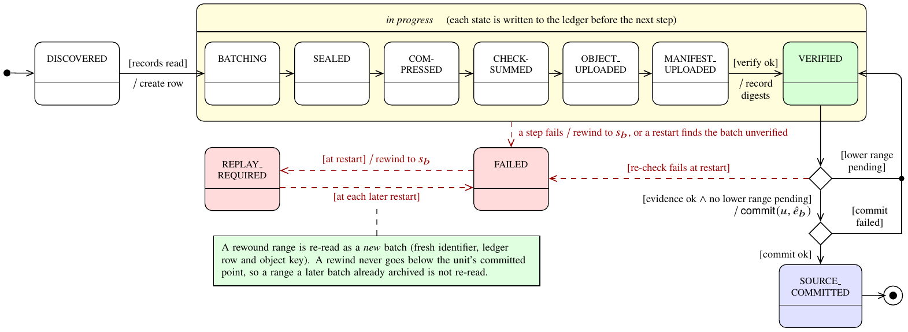
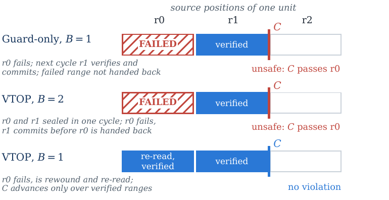

<div align="center">

# A Verification-Bound Commit and Recovery Protocol<br>for Heterogeneous Telemetry Archival

**Research artifact**

Tamir Suliman · Department of Computational and Data Sciences, George Mason University

[](https://doi.org/10.5281/zenodo.24124443)
[](LICENSE)
[](LICENSE-DATA)
[-teal.svg)](https://github.com/allamiro/vtop-engine/tree/v0.7.0)
[-orange.svg)](#citing)

*Model · fault-injection harnesses · independent oracle · raw run records · analysis · figures*

</div>

---

## The question

Telemetry pipelines move records from **Kafka partitions, append-only log files and syslog spools** into **cloud object storage**. At some point the pipeline advances the source's progress marker (a Kafka offset, a file cursor), and the source may then discard those records. **When is it safe to advance that marker?**

The paper's answer is VTOP. It binds each source range to a stored object and a manifest, advances the marker only after verifying the stored evidence, and re-checks that evidence before any commit made during crash recovery. This repository holds everything behind the paper's numbers.

## At a glance

<table>
<tr>
<td align="center" width="25%"><h2>0</h2>unsafe commits in <b>49</b> crash and outage trials<br><sub>285 kills · 42 outages · real logs</sub></td>
<td align="center" width="25%"><h2>64 / 64</h2>evidence mutations refused at restart<br><sub>size-only checks missed 4 / 4 byte flips</sub></td>
<td align="center" width="25%"><h2>793,353</h2>model states, no violation for v0.7.0<br><sub>the earlier logic fails after 32 states</sub></td>
<td align="center" width="25%"><h2>0.1–1.4 ms</h2>verification per 16 MiB batch<br><sub>vs 13.5–24.6 ms for compression</sub></td>
</tr>
</table>

## Key findings

1. **A per-batch "commit only from VERIFIED" guard is not sufficient.**
   - The earlier v0.6.0 logic had the guard and still committed past a failed range.
   - So does v0.7.0 if one source unit has two pending batches.
   - Safety also needs the failed range rewound and at most one pending batch per unit (Fig. 3; Theorem 1 in the paper).
2. **Under faults, the marker never passed the verified archive.**
   - An independent byte-exact oracle checked every crash snapshot.
   - No trial committed past verified, intact data.
   - 48 of 49 archives were complete. The remaining one hit a Kafka partition stall (900 s, cleared by a restart in 2 s): a liveness gap, not a loss.
3. **Strong verification is what catches same-size corruption.**
   - Re-verification at restart refused every mutated object or manifest.
   - With size-only checks, a flipped byte was committed behind the marker.
4. **Verification is cheap next to compression.**
   - With compressed objects, the cost was resolved only on BGL: 6.6–9.9% below size-only, from a 95% CI on the difference of medians. On SSH and HDFS it was within run-to-run variation.
   - Without compression, verification cost 20.4% (SSH) and 13.9% (BGL); the 12.3% on HDFS was not resolved.
5. **A response-based sink commits past damaged data; VTOP does not.**
   - Same Kafka topic, MinIO and oracle; the store acknowledged a write and then corrupted or lost it.
   - The Confluent S3 Sink 12.1.15 (exactly-once configuration) committed past the damaged object in 20 of 20 trials, leaving 40,000 committed records without an intact copy each time. VTOP: 0 of 20.
   - Under kills neither lost data. VTOP's cost was liveness: a Kafka partition stall in 4 of 27 trials (vtop-engine #623), safe but stuck until a restart.
6. **The price is at-least-once delivery.**
   - Replay can duplicate objects.
   - Rolling back the ledger after a power loss produced a median of 108 duplicate objects, replaying 108.9% of the source bytes.

## The protocol

<p align="center"></p>
<p align="center"><sub><b>Batch state machine (UML).</b> The ledger row is created when records are read, and every state in the compound state is written to the ledger before the next step. A failing step leads to FAILED and its range is rewound. At every restart, unfinished, FAILED and REPLAY_REQUIRED rows are persisted FAILED, then REPLAY_REQUIRED, before the rewind. The first choice commits only if the evidence holds and no lower range is pending; the second records the commit's outcome.</sub></p>

<p align="center"></p>
<p align="center"><sub><b>Why the guard is not enough.</b> In the v0.6.0 logic, and in v0.7.0 with two pending batches per unit, a later verified range commits past an earlier failed one. Both runs satisfy the per-batch guard.</sub></p>

## Repository map

| Path | What it is | Paper |
|---|---|---|
| [`model/vtop_model.py`](model/vtop_model.py) | Bounded explicit-state model of one source unit. Actions: reads, uploads, verification, adapter commit, crash, ledger-tail loss, storage mutation, rewind and recovery holdback | §V-D |
| [`results/rq1-model-sweep.tar.gz`](results/) | 18 model configurations, including the counterexample traces (full table in `analysis/tables/rq1_model_full.tex`) | §V-D, Table 3 |
| [`experiments/rq1-source-safety/`](experiments/rq1-source-safety/) and `results/rq1-v070-*.tar.gz` | Crash, outage, power-loss and Kafka fault injection: per-trial engine logs, ledgers (SQLite plus WAL, byte for byte), configurations and oracle verdicts | §VII-B, Table 4 |
| [`experiments/rq2-corruption-recovery/`](experiments/rq2-corruption-recovery/) and `results/rq2-v070-tamper.tar.gz` | Nine evidence mutations under three verification modes (108 trials) | §VII-C, Table 5 |
| [`experiments/rq3-cost-ablation/`](experiments/rq3-cost-ablation/) and `results/rq3-v070-cost*.tar.gz` | Verification cost, stage timings and the batch-size sweep | §VII-D, Figs. 4–6 |
| [`experiments/rq4-baselines/`](experiments/rq4-baselines/) and `results/rq4-v070-baseline.tar.gz` | VTOP vs the Confluent S3 Sink under acknowledged-but-corrupted/lost writes and kills: harness, S3 fault proxy, pinned versions (`configs/README.md`), 52 trial records, stall evidence | §VII-E, Table 6 |
| [`experiments/lib/vtoplab.py`](experiments/lib/vtoplab.py) | Shared harness and the independent byte-exact oracle | §VI, §VII |
| [`analysis/`](analysis/) | `analyze.py` builds every table, figure and `summary.json`; `verify_manuscript_data.py` checks the paper's numbers against them | all |
| [`datasets/loghub/`](datasets/loghub/) | `fetch.sh` and `inventory.csv` (SHA-256 of every input file) | §VII-A |
| [`RESULTS.md`](RESULTS.md) · [`hypotheses.md`](hypotheses.md) | Results summary and the hypothesis each result answers | — |
| [`SHA256SUMS`](SHA256SUMS) | Checksums of every file here | — |

## Reproduce

**Re-analyse the recorded runs (minutes, no engine needed):**
```bash
pip install zstandard matplotlib
for a in results/*.tar.gz; do tar -xzf "$a" -C experiments/; done   # see each experiment README for its results/ path
python analysis/scripts/analyze.py
python analysis/scripts/verify_manuscript_data.py
```

**Re-run the experiments (hours):**
```bash
git clone https://github.com/allamiro/vtop-engine && cd vtop-engine && git checkout v0.7.0 && cargo build --release
datasets/loghub/fetch.sh                  # Loghub inputs, checked against inventory.csv
experiments/run_v070.sh                   # RQ1-RQ3 on v0.7.0; Kafka trials need Docker (apache/kafka:3.9.1)
```
- **RQ4 baseline:** `experiments/rq4-baselines/code/exp_baseline.py`; needs Docker, the Confluent S3 Sink plugin and a MinIO image built from source. Steps and pinned versions are in `experiments/rq4-baselines/configs/README.md`.
- **Engine binary path:** the harness looks for it at `.tmp/vtop-engine-v0.7.0/target/release/vtopctl`. Set `VTOPCTL` in `experiments/lib/vtoplab.py` if yours is elsewhere.
- **Per-experiment details:** each experiment's `README.md` gives its exact parameters, seeds and expected outputs.
- **Integrity check:** `shasum -a 256 -c SHA256SUMS`.

## Scope

The artifact supports the paper's claims and nothing beyond them:
- **Platform:** one host and a local object-store backend. The service-side checksum cost on networked S3 was not measured.
- **Model:** the model abstracts the implementation; it is not a proof of the Rust code.
- **Safety condition:** safety holds under the paper's Assumptions 1–7, which include one engine per state store (v0.7.0 enforces this on one host). The Kafka adapter commit is not fenced against a second engine ([vtop-engine #614](https://github.com/allamiro/vtop-engine/issues/614), fixed after v0.7.0).
- **Delivery:** VTOP is at-least-once; duplicates on replay are expected.

## Data

The experiments use real system logs from **Loghub** (Zhu et al., ISSRE 2023). Loghub is free for research and academic use with attribution. This artifact does not redistribute it or any copy of it: trial inputs and ground-truth dumps are omitted, and `datasets/loghub/fetch.sh` rebuilds them.

## Citing

If you use this artifact, please cite the paper and the artifact. If you use the data, also cite Loghub.

```bibtex
@unpublished{suliman2026vtop,
  author = {Tamir Suliman and Tahani Abdalla Attia},
  title  = {A Verification-Bound Commit and Recovery Protocol for Heterogeneous Telemetry Archival},
  note   = {Manuscript prepared for submission to IEEE Transactions on Cloud Computing},
  year   = {2026}
}

@misc{suliman2026vtopartifact,
  author       = {Tamir Suliman},
  title        = {Research Artifact: A Verification-Bound Commit and Recovery Protocol for Heterogeneous Telemetry Archival},
  howpublished = {\url{https://github.com/allamiro/vtop-paper-artifact}},
  doi          = {10.5281/zenodo.24124444},
  note         = {Version 1.0.0; results pinned to vtop-engine v0.7.0 (6c8f386)},
  year         = {2026}
}

@inproceedings{zhu2023loghub,
  author    = {Jieming Zhu and Shilin He and Pinjia He and Jinyang Liu and Michael R. Lyu},
  title     = {Loghub: A Large Collection of System Log Datasets for {AI}-driven Log Analytics},
  booktitle = {Proceedings of the 2023 IEEE 34th International Symposium on Software Reliability Engineering (ISSRE)},
  pages     = {355--366},
  year      = {2023},
  doi       = {10.1109/ISSRE59848.2023.00071}
}
```

GitHub's **"Cite this repository"** button reads [`CITATION.cff`](CITATION.cff).

## License

- **Code** (`model/`, `experiments/`, `analysis/scripts/`): [MIT](LICENSE).
- **Run records, tables, figures and documentation:** [CC BY 4.0](LICENSE-DATA).
- **Loghub:** not included, and covered by its own terms.
