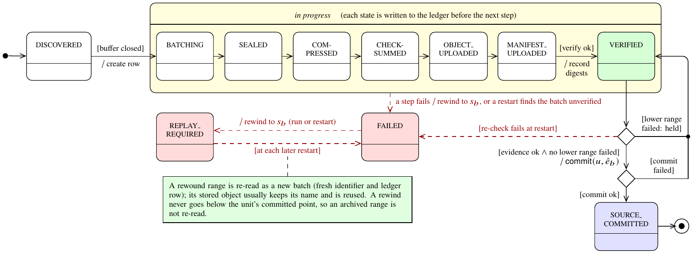
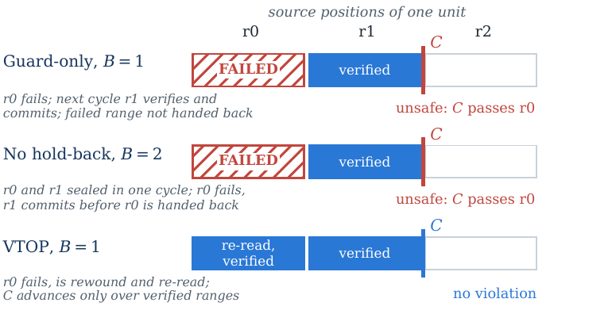

<div align="center">

# A Verification-Bound Commit and Recovery Protocol<br>for Heterogeneous Telemetry Archival

**Research artifact**

Tamir Suliman · Department of Computational and Data Sciences, George Mason University

[](https://doi.org/10.5281/zenodo.24124443)
[](LICENSE)
[](LICENSE-DATA)
[-teal.svg)](https://github.com/allamiro/vtop-engine/tree/v0.7.0)
[-teal.svg)](https://github.com/allamiro/vtop-engine/releases/tag/v0.10.2)
[-teal.svg)](https://github.com/allamiro/vtop-engine/releases/tag/v0.10.4)
[](#citing)

*Model · fault-injection harnesses · independent oracle · raw run records · analysis · figures · cloud runs on Amazon S3*

</div>

---

## The question

Telemetry pipelines move records from **Kafka partitions, append-only log files and syslog spools** into **cloud object storage**. At some point the pipeline advances the source's progress marker (a Kafka offset, a file cursor), and the source may then discard those records. **When is it safe to advance that marker?**

The paper's answer is VTOP. It binds each source range to a stored object and a manifest, advances the marker only after verifying the stored evidence, and re-checks that evidence before any commit made during crash recovery. This repository holds everything behind the paper's numbers.

**Three engine builds, kept apart.** Versions 1.0.x hold the evaluation of vtop-engine **v0.7.0** (6c8f386). Version 1.1.0 adds a re-run of the same experiments on **v0.10.2** (0abf116) and a cloud evaluation on EC2 and Amazon S3, and then re-runs everything on **v0.10.4** (be5b419), which is the build the paper reports ([what is new](#new-in-v110-vtop-engine-v0104-and-amazon-s3)).
- **v0.10.4 (be5b419) is the primary build of v1.1.0.** Its results are in `results/*-v0104-*` and `analysis/v0104/`.
- **v0.10.2 (0abf116) and v0.7.0 (6c8f386) are archived builds.** They stay in the artifact, side by side with v0.10.4 and never merged with it: the paper compares v0.10.2 with v0.10.4 (the RQ3 A/B slowdown, the tamper verdicts that changed), so those runs must stay reproducible.
- Every v0.7.0 file is unchanged from v1.0.4 (the v0.7.0 result archives hold the same files, re-packed with the owner `root`; see [Data](#data) for the redaction).

## At a glance (vtop-engine v0.10.4, the paper's build)

<table>
<tr>
<td align="center" width="25%"><h2>0</h2>unsafe commits in <b>49</b> crash and outage trials<br><sub>323 kills · 47 outages · 80 power-loss emulations · 49/49 archives complete</sub></td>
<td align="center" width="25%"><h2>64 / 64</h2>evidence mutations refused at restart<br><sub>size-only checks missed 4 / 4 byte flips; recovery without the re-check accepted 32 / 32</sub></td>
<td align="center" width="25%"><h2>2,356,152</h2>model states (B = 2), no violation<br><sub>the guard alone fails after 32 states</sub></td>
<td align="center" width="25%"><h2>0 / 20</h2>unsafe VTOP trials with acknowledged-but-damaged writes (0 / 5 under kills)<br><sub>the three other sinks committed past the damaged object in 20 / 20 trials each</sub></td>
</tr>
</table>

Every number is generated from the run records by `analysis/scripts/analyze.py --set v0104` (`analysis/v0104/summary.json`) and recomputed from the raw files by `analysis/scripts/verify_v0104_data.py`. `analysis/v0104/NUMBERS.md` lists each number next to its v0.10.2 counterpart and flags every difference; `analysis/v0104/DIFF-v0102.md` is the cell-by-cell diff of the two summaries.

**What changed between the builds (v0.10.2 → v0.10.4).**
- *Local throughput is about 40% lower* on v0.10.4 in every cell, size-only included. The cause is the local-filesystem backend's durable writes since v0.10.3 (file and directory fsync, vtop-engine #827): per batch, object upload rose from 0.0 to 12.6–20.3 ms and manifest upload from 0.0 to 8.5–10.5 ms. An interleaved A/B of both builds on one host (`results/rq3-v0102-v0104-ab.tar.gz`, `analysis/v0104/RQ3-AB.md`) gave v0.10.4 / v0.10.2 throughput of 0.61–0.81. Verification cost relative to size-only therefore differs between the builds and is not compared number for number.
- *Tampering:* swapping a signed manifest is now caught by `verify-manifest` (#882, v0.10.3); suspended versioning under a running engine now writes 1 object (#883, v0.10.4). `RESULTS.md` and `analysis/v0104/NUMBERS.md` list the cases.
- *Kafka resume:* since v0.10.3 the adapter resumes from the highest committed end of the topic id (#855).
- *Rewind:* v0.7.0 to v0.10.3 hand a failed range back to the highest failed start when two or more batches of one unit fail in the same cycle; v0.10.4 hands back the lowest (#891).
- *The RQ4 oracle* had a tie-break defect for identical records (`exp_baseline.locate()`); it is fixed (two-pass `locate()` and `reconcile()`, `experiments/rq4-baselines/code/test_locate.py`). One PERF run (`106-tput-vector-r4`) that had failed on the oracle, not on Vector, was re-judged offline (`experiments/rq5-cloud/perf/rejudge.py`, `rejudge-106-tput-vector-r4.json` in `results/rq5-v0104-perf.tar.gz`, `experiments/rq5-cloud/perf/LESSONS.md`).

## At a glance (vtop-engine v0.7.0, archived build)

<table>
<tr>
<td align="center" width="25%"><h2>0</h2>unsafe commits in <b>49</b> crash and outage trials<br><sub>285 kills · 42 outages · real logs</sub></td>
<td align="center" width="25%"><h2>64 / 64</h2>evidence mutations refused at restart<br><sub>size-only checks missed 4 / 4 byte flips</sub></td>
<td align="center" width="25%"><h2>793,353</h2>model states, no violation for v0.7.0<br><sub>the earlier logic fails after 32 states</sub></td>
<td align="center" width="25%"><h2>0.1–1.4 ms</h2>verification per 16 MiB batch<br><sub>vs 13.5–24.6 ms for compression</sub></td>
</tr>
</table>

## Key findings (vtop-engine v0.7.0, archived build)

1. **A per-batch "commit only from VERIFIED" guard is not sufficient.**
   - The earlier v0.6.0 logic had the guard and still committed past a failed range.
   - So does v0.7.0 if one source unit has two pending batches.
   - Safety also needs the failed range rewound and at most one pending batch per unit (Fig. 3; Theorem 1 in the paper).
2. **Under faults, the marker never passed the verified archive.**
   - An independent byte-exact oracle checked every crash snapshot.
   - No trial committed past verified, intact data.
   - 48 of 49 archives were complete. The remaining one hit a Kafka partition stall (900 s, cleared by a restart in 2 s): a liveness gap, not a loss.
3. **Strong verification is what catches same-size corruption.**
   - Re-verification at restart refused every mutated object or manifest.
   - With size-only checks, a flipped byte was committed behind the marker.
   - Ablation: a v0.7.0 build whose recovery skips the storage re-check accepted all 32 mutations, and 24 of them committed progress over damaged evidence. The re-check is what refuses them.
4. **Verification is cheap next to compression.**
   - With compressed objects, the cost was resolved only on BGL: 6.6–9.9% below size-only, from a 95% CI on the difference of medians. On SSH and HDFS it was within run-to-run variation.
   - Without compression, verification cost 20.4% (SSH) and 13.9% (BGL); the 12.3% on HDFS was not resolved.
   - On S3 over a local Docker network (150 runs) neither the store's own SHA-256 nor BLAKE3 read-back had a resolved cost; without compression throughput fell 63–67%.
   - With emulated round-trip latency (+20 / +50 ms, Toxiproxy, 135 runs) the store's SHA-256 stayed free, while read-back, which downloads every object again, cost 19–23% / 24–27%, resolved on every dataset. Every run drained and passed the oracle.
5. **Three widely used sinks commit past damaged data; VTOP does not.**
   - Same Kafka topic, MinIO and oracle; the store acknowledged a write and then corrupted or deleted it.
   - The Confluent S3 Sink 12.1.15 (exactly-once configuration), Vector 0.61.0 (end-to-end acknowledgements) and Fluent Bit 5.2.0 (filesystem buffering; commits on ingest) each committed past the damaged object in 20 of 20 trials. VTOP: 0 of 20.
   - Under kills no system lost data in the final state; Fluent Bit's offset was ahead of its archive at 6 of 15 kill events until its local buffer was uploaded.
   - Under kills neither lost data. VTOP's cost was liveness: a Kafka partition stall in 4 of 27 trials (vtop-engine #623), safe but stuck until a restart.
6. **The price is at-least-once delivery.**
   - Replay can duplicate objects.
   - Rolling back the ledger after a power loss produced a median of 108 duplicate objects, replaying 108.9% of the source bytes.

## New in v1.1.0: vtop-engine v0.10.4 and Amazon S3

### Primary build: vtop-engine v0.10.4 (be5b419)

**Local campaign on v0.10.4** (`experiments/run_v0104.sh`, progress log `experiments/campaign-v0104.txt`): same host type, datasets, trials, repetitions, seeds, configurations and 16 MiB batch size as the v0.10.2 campaign. The engine is the official v0.10.4 macOS arm64 release archive ([engine builds](#engine-builds)). Archives: `results/rq1-v0104-crash`, `rq1-v0104-kafka`, `rq2-v0104-tamper`, `rq2-v0104-norecheck`, `rq3-v0104-cost`, `rq3-v0104-cost-run`, `rq4-v0104-baseline` (`.tar.gz`, each with its per-trial `raw/` records), and the interleaved A/B `results/rq3-v0102-v0104-ab.tar.gz`. Compared cell by cell, from `analysis/v0104/NUMBERS.md`:

| Experiment | v0.7.0 (6c8f386), archived | v0.10.2 (0abf116), archived | **v0.10.4 (be5b419), primary** |
|---|---|---|---|
| RQ1 crash and outage, files, spools, power loss, HDFS, and Kafka (49 trials) | 0 unsafe; 48/49 complete | 0 unsafe; 49/49 complete; 284 kills, 42 outages | **0 unsafe, 49/49 complete; 323 kills, 47 outages; 0 duplicate objects in every trial** |
| RQ1 power loss | the whole WAL deleted | 69 WAL truncations to the last fsynced commit | **80 WAL truncations to the last fsynced commit** (47 dropped ledger commits, 408 in all); 0 duplicate objects, median |
| RQ1 manifest starts understated (#622) | 3,569 | 0 of 5,799 | **0 of 5,825** |
| RQ1 Kafka (14 trials) | 13/14 complete (one stall) | 14/14 complete, final drain median 4.6 s | **14/14 complete, no stall, final drain median 0.0 s** |
| RQ2 tampering (108 trials) | 64/64 refused; size-only accepted 4 | identical | **identical: 64/64 refused; size-only accepted the 4 bit flips** |
| RQ2 no-re-check ablation (36 trials) | 32/32 accepted, 24 unsafe | identical | **identical: 32/32 accepted, 24 unsafe** (env-gated patch on the v0.10.4 tag) |
| RQ4 VTOP side (25 trials) | 0 unsafe; 23/25 complete | 0 unsafe; 25/25 complete; longest 41 s | **0 unsafe; 25/25 complete; longest 40 s** |
| RQ3 local throughput (medians, MiB/s; 15 cells) | 263–369 | 271–361 | **152–207** (durable local writes, #827; see above) |
| RQ3 compressed-object verification cost vs size-only | 6.6–9.9% on BGL (unresolved on SSH, HDFS) | 4.3–6.6% | **6.9–11.1%** |
| RQ3 uncompressed, SSH / BGL / HDFS | 20.4% / 13.9% / 12.3% | 13.7% / 7.5% / 11.3% | **23.5% / 18.2% / 19.6%** |

The Confluent S3 Sink, Vector and Fluent Bit rows of RQ4 were not re-run: those trials are the v0.7.0-era runs in `results/rq4-v070-*.tar.gz`, paired with the new VTOP side.

**Cloud: EC2 and Amazon S3, v0.10.4 sessions of 2026-11-22** (`experiments/rq5-cloud/`; bucket in us-east-1; arm64 Graviton VMs that terminate themselves; records in `results/rq5-v0104-*.tar.gz`):
- **E-RQ5-COST** (t4g.medium, 90/90 runs pass): BLAKE3 read-back −16.3% (SSH), −19.3% (BGL), −17.8% (HDFS), all resolved; store SHA-256 −3.5%, −3.2%, −3.3%, resolved on BGL and HDFS (SSH [−6.6, 0.1] includes 0). **HDFS re-check on t4g.large** (30/30 pass): store SHA-256 −3.88% [−6.36, −1.93], read-back −18.95% [−21.16, −17.68].
- **E-RQ5-WAN** (t4g.medium engines in eu-west-1, sa-east-1, ap-northeast-1 and ap-southeast-2 writing to the us-east-1 bucket; 272/272 runs pass, 0 unsafe): RTT 66–196 ms; store SHA-256 2.9–10.0%, BLAKE3 read-back 23.0–36.4%. A 60 s partition: no commit during the cut, first commit 2.0–4.7 s after restore; SIGKILL during upload: restart drained in 6.4–16.2 s with 0 duplicate bytes; 5% packet loss: drains 7.9–12.6× slower, 1 failed batch. Under a 1 Mbit/s policer the shipped deadline (#663) committed everything in all four regions. Details: `results/rq5-v0104-wan.tar.gz` (`combined-v0104/ANALYSIS.md`).
- **E-RQ5-TAMPER** (55 cases on Amazon S3 and locally, signed manifests, versioning, Object Lock, audit chain): outcomes in `cases.jsonl` and `summary.json` of `results/rq5-v0104-tamper.tar.gz`; forged content was committed only in MAC-FORGE-OFF-BL, MAC-FORGE-OFF-BL-RCPT and MAC-LEAKED-BL; S3 refused 4 Object Lock and versioning requests; the AWS and local runs agree in 53 of 53 comparable cases. The two local MinIO runs of each build (`20261122-local-minio-v0104`, `-rep2`; likewise `20261121-local-minio-v0102*`) ran from a scratch directory: in the published copies that directory's path is replaced by `<scratch>` (also inside object keys) and their per-case `ledger.db` files are left out, because a database is not rewritten; `cases.jsonl`, `run.json`, the engine logs and the scrub records are included.
- **E-RQ5-SCALE** (1, 2, 4 and 8 engines on separate hosts, one bucket): aggregate 45.3 / 91.9 / 185.5 / 369.3 MiB/s; 198/198 engine-runs pass, 0 unsafe, 0 retries, 0 throttling.
- **E-RQ5-PERF** (VTOP, Confluent S3 Sink, Vector and Fluent Bit, 2 × t4g.large per leg, HDFS on Kafka, 16 MiB objects, in us-east-1 and from ap-southeast-2): VTOP store SHA-256 23.09 [21.10, 25.03] MiB/s in-region and 7.09 [6.76, 7.52] from Sydney; Confluent 1.64× / 3.65× of that, Vector 0.41× / 1.32×; CPU 24.0 s per GiB for VTOP (lowest, resolved), 53.1 Confluent, 203.8 Vector, 26.3 Fluent Bit; first commit 1.7 s after SIGKILL with 0 duplicates, while Vector duplicated up to 240,000 records. The storage-fault phase on real S3: the sinks committed past the damaged object in 30/30 trials (40,000–42,991 committed records lost per trial); the scrub flagged 10/10 VTOP trials.

**Analysis tables for v0.10.4.** `analysis/v0104/` (tables, figures, `summary.json`, `NUMBERS.md`, `DIFF-v0102.md`, `RQ3-AB.md`, and `package/` with the manuscript-ready figures and tables), regenerated with `analysis/scripts/analyze.py --set v0104` and checked by `analysis/scripts/verify_v0104_data.py`. The v0.7.0 tables and figures in `analysis/tables/` and `analysis/figures/` and the v0.10.2 ones in `analysis/v0102/` are unchanged.

### Archived build: vtop-engine v0.10.2 (0abf116) and Amazon S3

**Local re-run on v0.10.2** (`experiments/run_v0102.sh`, progress log `experiments/campaign-v0102.txt`). Same host type, datasets, trials, repetitions and seeds as v0.7.0. The engine is the official v0.10.2 macOS arm64 release archive ([engine builds](#engine-builds)). The engine configurations are the same as for v0.7.0. v0.10.2 honours the configured batch size in run mode (vtop-engine #824), whereas v0.7.0 cut run-mode batches at about twice the setting (about 32 MiB at 16 MiB), so throughput is not compared number for number. Compared cell by cell, from `RESULTS.md`:

| Experiment | v0.7.0 (6c8f386) | v0.10.2 (0abf116) |
|---|---|---|
| RQ1 file, spool, power-loss and HDFS crash (35 trials) | 230 kills, 0 unsafe, 35/35 complete; power loss: median 108 duplicate objects, replay amplification 1.089; 3,569 understated manifest starts | 228 kills, **0 unsafe** (at every crash and final), **35/35 complete**, 0 lost; **0 duplicate objects in every scenario, power loss included**; **0 understated manifest starts** (#622 fixed) |
| RQ1 Kafka (14 trials) | 0 unsafe, 13/14 complete (one stall left 80,181 records unarchived) | **0 unsafe, 14/14 complete, 0 lost**, median final drain 4.6 s |
| RQ2 tampering (108 trials, M0–M8) | strong and strong+MAC: 64/64 mutations detected; size-only accepted 4 (same-size bit flip); 4 unsafe commits, all size-only | **identical**: 64/64 detected; size-only accepted the 4 bit flips |
| RQ2 no-re-check ablation (36 trials) | 32/32 mutations accepted, 24 unsafe commits | **identical**: 32/32 accepted, 24 unsafe (env-gated patch on the v0.10.2 tag) |
| RQ4 VTOP side (25 trials) | 0 unsafe; 23/25 complete (2 stalls of 900 s) | **0 unsafe, 25/25 complete**, longest trial 41 s |
| RQ3 local throughput (medians, MiB/s) | 263–369 | 271–362 |

*Power loss.* The emulation changed with the engine. The v0.7.0 runs deleted the whole WAL, which is stronger than a power loss once VERIFIED and SOURCE_COMMITTED are fsynced. The v0.10.2 runs truncate the WAL after the last fsynced commit (`vtoplab.power_loss_truncate`, the engine's own method). The drop from 108 duplicates to 0 is the combined effect of the faithful emulation, the fsynced states and stable object keys; it is not attributed to any one of them.

**Cloud: EC2 and Amazon S3** (`experiments/rq5-cloud/`; bucket in us-east-1; arm64 Graviton VMs that terminate themselves; records under `results/rq5-*`):

- **E-RQ5-SMOKE** (v0.10.1, t4g.small, us-east-1): all four verification modes drained with 0 unsafe commits and byte-exact coverage; the store-SHA-256 mode used the checksum S3 computed (HeadObject with `ChecksumMode`), as VTOP's receipts state. The first two attempts failed in the test's own bootstrap and oracle and are kept (`LOG.md`).
- **E-RQ5-COST** (v0.10.2, t4g.medium, 90/90 runs pass): BLAKE3 read-back −14.3% (SSH), −18.7% (BGL), −19.8% (HDFS), all resolved; store SHA-256 unresolved on SSH and BGL. **HDFS re-check on t4g.large** (30/30 pass), run because the t4g.medium network allowance was being exceeded: store SHA-256 −5.07% [−7.06, −2.62], read-back −21.11% [−22.19, −19.23].
- **E-RQ5-WAN** (v0.10.2, t4g.medium engines in eu-west-1, sa-east-1, ap-northeast-1 and ap-southeast-2 writing to the us-east-1 bucket; 272/272 runs pass, 0 unsafe): RTT 66–196 ms; store SHA-256 −1% to −14%, BLAKE3 read-back −24% to −35%, growing with RTT. A 60 s partition and SIGKILL during upload recovered with no unsafe commit and no duplicate; 5% packet loss slowed runs 9–12× without failures; VTOP's egress cap matched kernel shaping for uploads. Sydney gives the valid policed-uplink check for #663. Details: `experiments/rq5-cloud/wan/results/combined/ANALYSIS.md` (in `results/rq5-v0102-wan.tar.gz`).
- **E-RQ5-TAMPER, E-RQ5-SCALE and E-RQ5-PERF on v0.10.2** (sessions of 2026-11-21; `results/rq5-v0102-tamper`, `rq5-v0102-scale`, `rq5-v0102-perf`): SCALE with 1, 2, 4 and 8 engines aggregated 46.6 / 93.0 / 188.1 / 373.1 MiB/s (198/198 engine-runs pass, 0 unsafe); PERF measured VTOP store SHA-256 at 19.61 [19.30, 20.51] MiB/s in-region and 6.05 [6.03, 6.16] from Sydney. The v0.10.2 to v0.10.4 differences of all three are listed in `analysis/v0104/NUMBERS.md`.

**Model.** The `v010` variant of `model/vtop_model.py` encodes the v0.10.x commit logic (per-cycle hold-back, two windows per unit, SUPERSEDED). It is safe at B = 1, 2, 3 (up to 2.36M states). The hold-back is necessary at B = 2, and a single refused replay violates I2, which shows that the paper's replayable-source assumption is needed. Results are in `model/results/20261120-v010-sweep*`. The engine changes behind the variant, and their check against the source, are in `model/v0101-changes.md` and `model/v0101-verification.md`.

**Analysis tables for v0.10.2.** Regenerated from the v0.10.2 run records by `analysis/scripts/analyze.py` into `analysis/v0102/` (tables, figures, `summary.json`). The v0.7.0 tables and figures in `analysis/tables/` and `analysis/figures/` are unchanged.

## The protocol

<p align="center"></p>
<p align="center"><sub><b>Batch state machine (UML).</b> Read records wait in the unit's in-memory pending buffer; the ledger row is created when that buffer is closed, and every state in the compound state is written to the ledger before the next step. A failing step leads to FAILED and its range is rewound. At every restart, unfinished, FAILED and REPLAY_REQUIRED rows are persisted FAILED, then REPLAY_REQUIRED, before the rewind. The first choice commits only if the evidence holds and no lower range is pending; the second records the commit's outcome.</sub></p>

<p align="center"></p>
<p align="center"><sub><b>Why the guard is not enough.</b> In the v0.6.0 logic, and in v0.7.0 with two pending batches per unit, a later verified range commits past an earlier failed one. Both runs satisfy the per-batch guard.</sub></p>

## Repository map

| Path | What it is | Paper |
|---|---|---|
| [`model/vtop_model.py`](model/vtop_model.py) | Bounded explicit-state model of one source unit. Actions: reads, uploads, verification, adapter commit, crash, ledger-tail loss, storage mutation, rewind and recovery holdback | §V-D |
| [`results/rq1-model-sweep.tar.gz`](results/) | 18 model configurations, including the counterexample traces (full table in `analysis/tables/rq1_model_full.tex`) | §V-D, Table 3 |
| [`experiments/rq1-source-safety/`](experiments/rq1-source-safety/) and `results/rq1-v070-*.tar.gz` | Crash, outage, power-loss and Kafka fault injection: per-trial engine logs, ledgers (SQLite plus WAL, byte for byte), configurations and oracle verdicts | §VII-B, Table 4 |
| [`experiments/rq2-corruption-recovery/`](experiments/rq2-corruption-recovery/) and `results/rq2-v070-tamper.tar.gz`, `results/rq2-v070-norecheck.tar.gz` | Nine evidence mutations under three verification modes (108 trials), and the no-re-check ablation (36 trials; build it from tag v0.7.0 with `code/norecheck.patch`) | §VII-C, Table 5 |
| [`experiments/rq3-cost-ablation/`](experiments/rq3-cost-ablation/), `results/rq3-v070-cost*.tar.gz` and `results/rq3-v070-s3-cost.tar.gz` (S3, clean re-run, emulated latency) | Verification cost, stage timings and the batch-size sweep | §VII-D, Figs. 4–6 |
| [`experiments/rq4-baselines/`](experiments/rq4-baselines/), `results/rq4-v070-baseline.tar.gz` and `results/rq4-v070-vector-fluentbit.tar.gz` | VTOP vs the Confluent S3 Sink under acknowledged-but-corrupted/lost writes and kills: harness, S3 fault proxy, pinned versions (`configs/README.md`), 52 trial records, stall evidence | §VII-E, Table 6 |
| [`experiments/lib/vtoplab.py`](experiments/lib/vtoplab.py) | Shared harness and the independent byte-exact oracle. `VTOP_BUILD` selects the engine (default v0.7.0) | §VI, §VII |
| `results/*-v0104-*.tar.gz`, `results/rq3-v0102-v0104-ab.tar.gz`, [`experiments/run_v0104.sh`](experiments/run_v0104.sh), [`experiments/campaign-v0104.txt`](experiments/campaign-v0104.txt) | v1.1.0, **primary build**: the RQ1–RQ4 re-run on v0.10.4 with each trial's `raw/` records, and the interleaved v0.10.2/v0.10.4 RQ3 A/B | — |
| `results/*-v0102-*.tar.gz`, [`experiments/run_v0102.sh`](experiments/run_v0102.sh), [`experiments/campaign-v0102.txt`](experiments/campaign-v0102.txt) | v1.1.0: the RQ1–RQ4 re-run on v0.10.2, with each trial's `raw/` records (configurations, engine logs, ledgers with WAL) | — |
| [`experiments/rq2-corruption-recovery/norecheck-v0.10.patch`](experiments/rq2-corruption-recovery/norecheck-v0.10.patch), [`build_norecheck.sh`](experiments/rq2-corruption-recovery/build_norecheck.sh) | v1.1.0: the no-re-check ablation for v0.10.x, gated on `VTOP_ABLATION_NORECHECK` (the binary behaves as the release when it is unset) | — |
| [`experiments/rq5-cloud/`](experiments/rq5-cloud/) and `results/rq5-*.tar.gz` | v1.1.0: cloud stages (smoke, cost incl. HDFS re-check, WAN in four regions, tamper, scale, perf; `*-v0104-*` records are the primary build, `*-v0102-*` the archived one), the launcher `run-ec2.sh`, `LOG.md` (every action, chronological) and `LESSONS.md` | — |
| [`model/results/`](model/results/), [`model/v0101-changes.md`](model/v0101-changes.md), [`model/v0101-verification.md`](model/v0101-verification.md) | v1.1.0: v010 model sweeps and the rule ablation; the v0.7.0 → v0.10.x change list and its check against the engine source | — |
| [`analysis/`](analysis/) | `analyze.py` builds every table, figure and `summary.json`; `verify_manuscript_data.py` checks the paper's numbers against them | all |
| [`datasets/loghub/`](datasets/loghub/) | `fetch.sh` and `inventory.csv` (SHA-256 of every input file) | §VII-A |
| [`RESULTS.md`](RESULTS.md) · [`hypotheses.md`](hypotheses.md) | Results summary and the hypothesis each result answers | — |
| [`CHANGELOG.md`](CHANGELOG.md) | What each version added | — |
| [`SHA256SUMS`](SHA256SUMS) | Checksums of every file here | — |

## Reproduce

**Re-analyse the recorded runs (minutes, no engine needed):**
```bash
pip install zstandard matplotlib
for a in results/*.tar.gz; do tar -xzf "$a" -C experiments/; done   # see each experiment README for its results/ path
python analysis/scripts/analyze.py
python analysis/scripts/verify_manuscript_data.py
```

**Re-run the experiments (hours):**

Build prerequisites: the engine's Kafka adapter compiles librdkafka with SSL and SASL. On macOS run
`brew install cmake openssl@3 cyrus-sasl`, set `OPENSSL_DIR` and `OPENSSL_ROOT_DIR` to `$(brew --prefix openssl@3)`,
and add both packages' `lib/pkgconfig` to `PKG_CONFIG_PATH`; on
Debian/Ubuntu install `cmake clang libssl-dev libsasl2-dev libcurl4-openssl-dev zlib1g-dev pkg-config`
(as in vtop-engine's `.github/workflows/release.yml` at v0.7.0). The Kafka trials need this default build;
`cargo build --release --no-default-features` skips the Kafka adapter and suffices only for file and spool runs.
```bash
git clone https://github.com/allamiro/vtop-engine && cd vtop-engine && git checkout v0.7.0 && cargo build --release
datasets/loghub/fetch.sh                  # Loghub inputs, checked against inventory.csv
experiments/run_v070.sh                   # RQ1-RQ3 on v0.7.0; Kafka trials need Docker (apache/kafka:3.9.1)
```
- **RQ4 baseline:** `experiments/rq4-baselines/code/exp_baseline.py`; needs Docker, the Confluent S3 Sink plugin and a MinIO image built from source. Steps and pinned versions are in `experiments/rq4-baselines/configs/README.md`.
- **Engine binary path:** the harness looks for it at `.tmp/vtop-engine-v0.7.0/target/release/vtopctl`. Set `VTOPCTL` in `experiments/lib/vtoplab.py` if yours is elsewhere.
- **Per-experiment details:** each experiment's `README.md` gives its exact parameters, seeds and expected outputs.
- **Integrity check:** `shasum -a 256 -c SHA256SUMS`.

**Unpacking the run records.** The v1.0.x archives (`*-v070-*`, `rq1-model-sweep`) hold the results directory itself; extract each into its experiment's `results/` folder, for example `tar -xzf results/rq1-v070-crash.tar.gz -C experiments/rq1-source-safety/results/`. The v1.1.0 archives (`*-v0104-*`, `*-v0102-*`, `rq5-*`) are rooted at `experiments/`:
```bash
for a in results/*-v0104-*.tar.gz results/*-v0102-*.tar.gz results/rq5-*.tar.gz; do tar -xzf "$a" -C experiments/; done
```
Commands in the experiment READMEs, `LOG.md` and the run records are written from the root of the paper's working repository, where this artifact's `experiments/` is `research/experiments/` and `analysis/` is `research/analysis/`.

**Re-run on v0.10.4 (hours, no cloud).** Download the release archive for your platform from the [v0.10.4 release](https://github.com/allamiro/vtop-engine/releases/tag/v0.10.4) and check it against `docs/vtop-engine-0.10.4-SHA256SUMS` and its cosign bundle ([engine builds](#engine-builds)). Then:
```bash
VTOP_BUILD=v0.10.4 experiments/run_v0104.sh       # correctness first; RQ3 timing waits for a quiet host
```
The harness expects the binary at `.tmp/vtop-engine-v0.10.4-dl/vtop-engine-0.10.4-aarch64-apple-darwin/vtopctl`; set `VTOPCTL` and `VTOP_COMMIT` to use another path. The no-re-check ablation needs its own build: `experiments/rq2-corruption-recovery/build_norecheck.sh v0.10.4`. To regenerate the tables, figures and numbers after unpacking the archives: `python analysis/scripts/analyze.py --set v0104`, then `python analysis/scripts/verify_v0104_data.py`.

**Re-run on v0.10.2 (hours, no cloud, archived build).** Download the release archive for your platform from the [v0.10.2 release](https://github.com/allamiro/vtop-engine/releases/tag/v0.10.2) and check it against `docs/vtop-engine-0.10.2-SHA256SUMS` and its cosign bundle ([engine builds](#engine-builds)). Then:
```bash
VTOP_BUILD=v0.10.2 experiments/run_v0102.sh       # correctness first; RQ3 timing waits for a quiet host
```
The harness expects the binary at `.tmp/vtop-engine-v0.10.2-dl/vtop-engine-0.10.2-aarch64-apple-darwin/vtopctl`; set `VTOPCTL` and `VTOP_COMMIT` to use another path. The no-re-check ablation needs its own build: `experiments/rq2-corruption-recovery/build_norecheck.sh v0.10.2` (a vtop-engine checkout next to the repository, Rust, and the build prerequisites above).

**Cloud runs (needs an AWS account; costs money).** Each stage README (`experiments/rq5-cloud/{smoke,cost,wan}/README.md`) gives the exact launch command, parameters, failsafes and clean-up. The stage READMEs were written before launch; outcomes are in `LOG.md` and the run records. Setup, all recorded in `LOG.md` and `LESSONS.md`:
- an S3 bucket in us-east-1, with public access blocked;
- an instance profile with S3 access to that bucket only, so no keys are placed on the VMs;
- a restricted operator IAM user;
- a default VPC in each region used.

`run-ec2.sh` launches one self-terminating VM, stages the code, waits, and downloads the results. Set `BUCKET`, `ARN_EXPECT` and `AWS_PROFILE` for your account; the defaults are this study's.

| Stage | Engine | Hosts | Measured VM time | Estimated cost (USD, from the stage README; prices read 2026-11-20/21) |
|---|---|---|---|---|
| E-RQ5-SMOKE | v0.10.1 | 3 × t4g.small, us-east-1 | about 2 min each | ≈ 0 |
| E-RQ5-COST | v0.10.2 | t4g.medium, us-east-1 | 2,868 s | ≈ 0.19 expected (cap ≈ 0.40) |
| HDFS re-check | v0.10.2 | t4g.large, us-east-1 | 1,715 s | ≈ 0.10 |
| E-RQ5-WAN | v0.10.2 | 4 × t4g.medium (eu-west-1, sa-east-1, ap-northeast-1, ap-southeast-2) | 2,485 / 2,990 / 3,457 / 4,010 s | ≈ 0.55 expected, ≈ 0.87 with the CPU-credit bound (cap ≈ 1.65) |

The table lists the COST, HDFS re-check and WAN stages of the first campaign (v0.10.2, 2026-11-21); TAMPER, SCALE and PERF ran on v0.10.2 the same day. The v0.10.4 sessions of 2026-11-22 repeated all of these stages; their VM times are in each run's `run.json` and `exit.json`, and no billed amounts are recorded in this artifact. The billed amounts of the first campaign were not yet available from AWS Cost Explorer when that version was prepared (it lags by up to a day), so the table gives the estimates; the whole campaign was planned to stay around USD 1–2. Cross-region transfer is charged per GB, so the WAN stage costs most.

## Engine builds

| Build | Used for | Source | How it was checked |
|---|---|---|---|
| v0.7.0, commit 6c8f386 | every v1.0.x result | built from tag `v0.7.0` (`cargo build --release`) | tag and commit checked in the checkout; `vtopctl --version` 0.7.0 |
| v0.7.0 + `norecheck.patch` | no-re-check ablation, v0.7.0 | tag `v0.7.0` with `experiments/rq2-corruption-recovery/code/norecheck.patch` | as above |
| v0.10.1, commit 44f6619 | E-RQ5-SMOKE only | release archive `vtop-engine-0.10.1-aarch64-unknown-linux-gnu.tar.gz`, SHA-256 `173aa74cd79af1d20dc0a6d6b831eab800e83e87926942b1e9be3ff9dd0f82f0` | checked against the release's `SHA256SUMS` on the VM |
| v0.10.2, commit 0abf116 (tag object 90e15fa3) | local re-run (macOS arm64) and E-RQ5-COST/-WAN (Linux arm64) | release archives `vtop-engine-0.10.2-aarch64-apple-darwin.tar.gz`, SHA-256 `a4a46d53c4c1d9b0d5f082f1394fabfa0280ec4a2b1a7863c0d4174d8c49e55e`, and `vtop-engine-0.10.2-aarch64-unknown-linux-gnu.tar.gz`, SHA-256 `5872e5a34b75a38425fcb99db2f78631b89d121b6a615a570192d5d4f2ccdf39`; cloud `vtopctl` SHA-256 `eef59073cab8f0c153fad98f16994dab0d64174e30740adfecc20cb4d7e5b6a6` (recorded in every cloud `run.json`) | both archives match the release's `SHA256SUMS` (included as `docs/vtop-engine-0.10.2-SHA256SUMS`, file SHA-256 `2cd50f9f…41b4`); `cosign verify-blob` with the release's `.sigstore.json` bundles: Verified OK, identity `https://github.com/allamiro/vtop-engine/.github/workflows/release.yml@refs/tags/v0.10.2`, issuer `https://token.actions.githubusercontent.com`; the VMs re-check the pinned archive SHA-256 before running |
| **v0.10.4, commit be5b419** (primary build) | local campaign (macOS arm64) and every 2026-11-22 cloud stage (Linux arm64) | release archives `vtop-engine-0.10.4-aarch64-apple-darwin.tar.gz`, SHA-256 `fc132e7cb0203ac8a75f910801e641f9271e32e0fe112913df289120bc049b71`, and `vtop-engine-0.10.4-aarch64-unknown-linux-gnu.tar.gz`, SHA-256 `0266c37b1f8740793f71724cddc5283c0aceb8faeda4e6bdea0d714ca8f37c84`; macOS `vtopctl` SHA-256 `542c30dfe477e42a8173e4fb78e915a809902bea6b76b2dee1195cf8c9d715c1`; cloud `vtopctl` SHA-256 `25d68a0e4c2229e9bbbb67eef1cd10ae57af8c53b16ac948cea72f88f5d0bcf4` (recorded in every cloud `run.json`) | both archives match the release's `SHA256SUMS` (included as `docs/vtop-engine-0.10.4-SHA256SUMS`, file SHA-256 `90e807f518abb869f7f161f588f74b0c82013ae4cba58fd52211b81d720d0ff4`); `cosign verify-blob` with the release's `.sigstore.json` bundles: Verified OK for both archives, identity `https://github.com/allamiro/vtop-engine/.github/workflows/release.yml@refs/tags/v0.10.4`, issuer `https://token.actions.githubusercontent.com`; `vtopctl --version` 0.10.4; the VMs re-check the pinned archive SHA-256 before running |
| v0.10.4 + `norecheck-v0.10.patch` | no-re-check ablation, v0.10.4 | tag `v0.10.4` built with `build_norecheck.sh v0.10.4` | `vtopctl` SHA-256 `34623d59d4fa0c3fca6a988bceafc8766e2639046b927ecbbe4f7072f514e56e`, patch SHA-256 `78158b8f87de42203a2459d48dbb20829ecdb4a442b31b8209005cfe6f0c3f6e`, recorded in the run's `run.json` |
| v0.10.2 + `norecheck-v0.10.patch` | no-re-check ablation, v0.10.2 | tag `v0.10.2` built with `build_norecheck.sh v0.10.2` | `vtopctl` SHA-256 `22efcc4ed59c98e9a52a9692dff5a4ece4a42b12eccddd586271e30dfeea2274`, recorded in the run's `run.json` |

To check the v0.10.4 archive (the primary build) yourself:
```bash
shasum -a 256 -c docs/vtop-engine-0.10.4-SHA256SUMS --ignore-missing
cosign verify-blob --bundle vtop-engine-0.10.4-aarch64-apple-darwin.tar.gz.sigstore.json \
  --certificate-identity https://github.com/allamiro/vtop-engine/.github/workflows/release.yml@refs/tags/v0.10.4 \
  --certificate-oidc-issuer https://token.actions.githubusercontent.com vtop-engine-0.10.4-aarch64-apple-darwin.tar.gz
```
The v0.10.2 archive (archived build) is checked the same way:
```bash
shasum -a 256 -c docs/vtop-engine-0.10.2-SHA256SUMS --ignore-missing
cosign verify-blob --bundle vtop-engine-0.10.2-aarch64-apple-darwin.tar.gz.sigstore.json \
  --certificate-identity https://github.com/allamiro/vtop-engine/.github/workflows/release.yml@refs/tags/v0.10.2 \
  --certificate-oidc-issuer https://token.actions.githubusercontent.com vtop-engine-0.10.2-aarch64-apple-darwin.tar.gz
```

## Implementation defects found by this study

All six are in the evaluated release (v0.7.0); their fixes are released in [v0.8.0](https://github.com/allamiro/vtop-engine/releases/tag/v0.8.0) (commit 6669b3b) of
[vtop-engine](https://github.com/allamiro/vtop-engine). None changes the protocol argument. The stall class is not claimed closed (see #675).

| Defect (as described in the paper, §VI) | Issue | Fix |
|---|---|---|
| A manifest built from several reads records the last read's start (the ledger keeps the full start) | #622 | PR #630 |
| The Kafka offset commit is not fenced against a second engine | #614 | PR #617 |
| A Kafka partition can stall until a restart | #623 | PR #644; a stall-recovery test failed once in CI after it, open as #675 with no root cause yet |
| Failed ledger rows are never pruned | #567 | PR #655 |
| A replay that recovery could not record is not held back | #639 | PR #645 |
| A failed range of a rotated file is not handed back | #621 | PR #647 |

## Scope

The artifact supports the paper's claims and nothing beyond them:
- **Platform:** the v0.7.0 results come from one host with a local object-store backend (and S3 over a local Docker network). The v0.10.2 and v0.10.4 cloud results add Amazon S3 in us-east-1, with engines in us-east-1 and four other regions; one engine host per run, except E-RQ5-SCALE, which runs 1 to 8 independent engines on separate hosts against one bucket (one engine per ledger); no multi-host source cluster. E-RQ5-PERF compares VTOP with the Confluent S3 Sink, Vector and Fluent Bit on EC2 for one workload (HDFS on Kafka, 16 MiB objects).
- **Model:** the model abstracts the implementation; it is not a proof of the Rust code.
- **Safety condition:** safety holds under the paper's Assumptions 1–7, which include one engine per state store (v0.7.0 enforces this on one host). The Kafka adapter commit is not fenced against a second engine ([vtop-engine #614](https://github.com/allamiro/vtop-engine/issues/614), fixed in v0.8.0).
- **Delivery:** VTOP is at-least-once; duplicates on replay are expected.

## Data

The experiments use real system logs from **Loghub** (Zhu et al., ISSRE 2023). Loghub is free for research and academic use with attribution. This artifact does not redistribute it or any copy of it: trial inputs, ground-truth dumps and the RQ4 ground-truth cache are omitted, and `datasets/loghub/fetch.sh` rebuilds them. **Redaction.** Two private identifiers are replaced in every published file, inside every archive and in the archives' owner fields: the AWS account id of the study (also part of the bucket names, ARNs and S3 host names) reads `XXXXXXXXXXXX`, so the buckets read `vtop-eval-XXXXXXXXXXXX` and `vtop-eval-lock-XXXXXXXXXXXX`; and the local user name in the home directory of the paper repository reads `REDACTED` (`/Users/REDACTED/...`, and `_Users_REDACTED_...` where the engine wrote that path into an object key). Both placeholders have the length of the text they replace, so no length, offset or measured value changes, a key reads the same in a ledger and in the JSON records, and the SQLite ledgers stay valid: their bytes are rewritten in place, and in a write-ahead log the checksums of exactly the frames that were valid before are re-sealed, so SQLite replays the same frames (this matters for the power-loss runs). The build (`public_text.py --redact`) checks every rewritten database: `PRAGMA integrity_check` passes and every row equals the original row after the same replacement. Hashes recorded over the original bytes (manifest digests, the ledger's audit chain) no longer match a redacted text. The buckets were deleted after the campaign, so the scripts need your own bucket and account (`BUCKET`, `ARN_EXPECT`) in any case. The v0.7.0 archives hold the same files as in v1.0.4; they are re-packed with the owner `root` (so are the engine-log bundles `engine-logs.tar.gz` inside `rq1-v070-kafka`, with the same log files), and in `rq3-v070-s3-cost` the home path in `20261111-v070-minio-latency/ENVIRONMENT-NOTES.md` is redacted. Freed space in a database page can keep a partly overwritten old path (only its head after `/Users/`, or only its tail before `/Desktop`); such fragments of the user name get the matching part of `REDACTED`. Two further edits concern text only and no measured value: the analysis scripts and notes call the manuscript folder `paper/` (it is not part of the artifact), and in the v0.7.0 environment notes of `rq3-v070-s3-cost` the process name of one desktop app in the CPU lists reads `REDACTED Helper`, and one note says "A review identified" where it named the reviewing tool; the CPU percentages and the overlap windows are unchanged.

The region map (`analysis/figures/rq5-regions.pdf`) uses the Natural Earth 1:110m land polygons (public domain), included in `analysis/data/naturalearth/`.

## Citing

If you use this artifact, please cite the paper and the artifact. If you use the data, also cite Loghub.

```bibtex
@unpublished{suliman2026vtop,
  author = {Tamir Suliman},
  title  = {A Verification-Bound Commit and Recovery Protocol for Heterogeneous Telemetry Archival},
  note   = {Manuscript in preparation},
  year   = {2026}
}

@misc{suliman2026vtopartifact,
  author       = {Tamir Suliman},
  title        = {Research Artifact: A Verification-Bound Commit and Recovery Protocol for Heterogeneous Telemetry Archival},
  howpublished = {\url{https://github.com/allamiro/vtop-paper-artifact}},
  doi          = {10.5281/zenodo.24124443},
  note         = {Version 1.1.0; results pinned to vtop-engine v0.10.4 (be5b419); v0.10.2 (0abf116) and v0.7.0 (6c8f386) archived},
  year         = {2026}
}

@inproceedings{zhu2023loghub,
  author    = {Jieming Zhu and Shilin He and Pinjia He and Jinyang Liu and Michael R. Lyu},
  title     = {Loghub: A Large Collection of System Log Datasets for {AI}-driven Log Analytics},
  booktitle = {Proceedings of the 2023 IEEE 34th International Symposium on Software Reliability Engineering (ISSRE)},
  pages     = {355--366},
  year      = {2023},
  doi       = {10.1109/ISSRE59848.2023.00071}
}
```

GitHub's **"Cite this repository"** button reads [`CITATION.cff`](CITATION.cff).

## License

- **Code** (`model/`, `experiments/`, `analysis/scripts/`): [MIT](LICENSE).
- **Run records, tables, figures and documentation:** [CC BY 4.0](LICENSE-DATA).
- **Loghub:** not included, and covered by its own terms.
